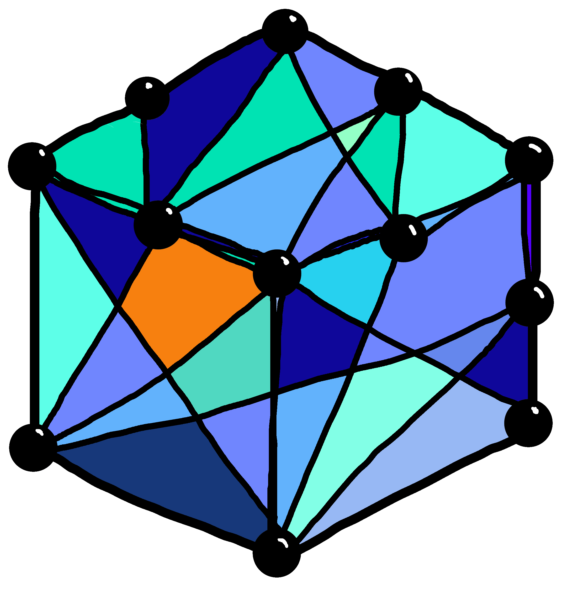

<div align="center">
  
  

  <br><br>

[](https://brorh.github.io/pycauset/)
[](https://badge.fury.io/py/pycauset)
[](https://opensource.org/licenses/MIT)

</div>

## **NumPy for causal sets.**

[Causal set theory](https://en.wikipedia.org/wiki/Causal_sets) is a discrete proposal for [quantum gravity](https://en.wikipedia.org/wiki/Quantum_gravity). Its objects are large matrices: causal matrices, their powers and closures, propagators. PyCauset is the matrix engine for them.

If you know [NumPy](https://numpy.org/), you know PyCauset: the same shapes, dtypes, operators and results, NumPy being the reference every operation is tested against. Underneath is a C++ core built for causal-set matrices: causal matrices stored one bit per element, matrix classes that know their structure (triangular, symmetric, diagonal, ...) and skip the work it makes unnecessary, and storage that moves to disk when RAM runs out.

Read the [documentation](https://brorh.github.io/pycauset/).

## Quick start

```python
import pycauset as pc   # import PyCauset before NumPy (they use separate BLAS thread pools)
import numpy as np

C = pc.causal_matrix(np.triu(np.ones((1000, 1000), dtype=bool), 1))   # a 1000-element chain, 1 bit per entry
paths = C @ C                      # 2-step path counts (int32), computed on the bits
R = C + C.T                        # comparability matrix: a lazy view, no memory until read

c = pc.causet(n=2000, spacetime=pc.spacetime.MinkowskiDiamond(4), seed=1)   # sprinkle a 4D diamond
c.myrheim_meyer_dimension()        # about 4, read off the order alone
len(c.longest_chain())             # the height of the order

A = pc.matrix(np.random.default_rng(0).standard_normal((500, 500)))
x = pc.solve(A, pc.vector(np.ones(500)))    # like np.linalg.solve
w = pc.eigvalsh(A + A.T)                    # LAPACK, NumPy's dtypes and conventions
```

## Features

- **It speaks NumPy.** Same shapes, dtypes, operators and broadcasting; mix PyCauset matrices with NumPy arrays freely. Every operation, in every dtype, structure and view, is checked against NumPy (the operation atlas, about 88,000 combinations).
- **Bit-packed causal matrices.** One bit per relation (8x less than bytes); products, sums and closures run on the packed words.
- **Structure-aware.** Triangular, symmetric, antisymmetric, Hermitian, diagonal and identity matrices store only what they need, and operations keep the structure when the result has it.
- **Bigger than RAM.** Matrices above a memory threshold live in memory-mapped files; operations that do not fit run tile by tile.
- **Fast.** The same OpenBLAS/LAPACK as NumPy; the target is at least 0.9x NumPy's speed in memory (`review/atlas/TIMING.md`), and the structured classes are often faster.

- **Causal sets.** Sprinkle into the Minkowski diamond in any dimension, read links, chains, layers and intervals off the order, estimate the dimension, or build synthetic orders. Fields, plots and the wider spacetime library are parked in `experimental/physics` while R1 completes the engine.

## Installation

```bash
pip install pycauset
```

Pre-compiled wheels for Windows, macOS, and Linux. From source:

```bash
git clone https://github.com/BrorH/pycauset.git
cd pycauset
pip install .
```

### Debug mode

Set `pycauset.debug_mode = True` (default `False`) to print diagnostics to stderr:
matrix shape/dtype and whether each is in RAM or spilled to disk, operation timings
(`matmul`, `@`, `invert`, `solve`, …), storage configuration changes, and file I/O. Every line is prefixed `[pycauset]`.

```python
import pycauset as pc
pc.debug_mode = True

A = pc.zeros((2000, 2000), dtype=pc.float64)   # [pycauset] allocated DenseMatrix (float64) 2000x2000 float64 RAM
C = A @ A                                       # [pycauset] matmul ... : 1.2s
```

## Status

Pre-alpha, no backwards compatibility between versions. R1 is the linear-algebra engine with the causal-set basics, CPU only; GPU support (`experimental/cuda`) and the rest of the physics layer (`experimental/physics`) are parked until it is complete. The ongoing review and its plan are in `review/`.

## Documentation

Guides, API reference, and the roadmap: [brorh.github.io/pycauset](https://brorh.github.io/pycauset/)

## License

[MIT](https://opensource.org/licenses/MIT). If you use PyCauset in your research, please cite [the repository](https://github.com/BrorH/pycauset).

Questions and ideas: bror dot hjemgaard at gmail dot com

This repository contains AI-generated code.
