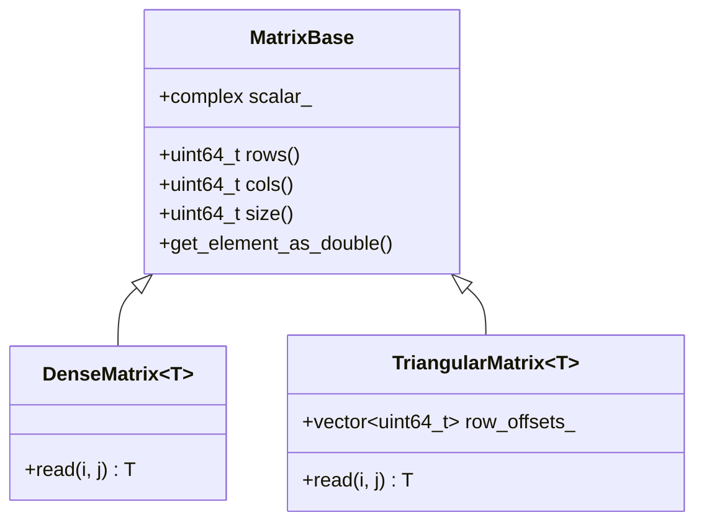

Matrices are the backbone of PyCauset. The engine follows NumPy conventions, so it feels familiar.

`pycauset` behaves like NumPy at small scales (storing data in RAM), but keeps large matrices in memory-mapped files on disk (automatically, above a size threshold or when RAM is short).

# Creating a Matrix

Matrices can be created from data using **[[docs/functions/pycauset.matrix.md|pycauset.matrix]]**. Allocation is done via **[[docs/functions/pycauset.zeros.md|pycauset.zeros]]**, **[[docs/functions/pycauset.ones.md|pycauset.ones]]**, or **[[docs/functions/pycauset.empty.md|pycauset.empty]]**.

## Rectangular support (what is and isn’t NxM)

- **Dense numeric matrices are rectangular-aware**: for integer/float/complex dtypes you can allocate and operate on `(rows, cols)` shapes.
- **Dense boolean/bit matrices are rectangular-aware**: `dtype="bool"` / `dtype="bit"` maps to `DenseMatrix` (dtype `bool`) and supports `(rows, cols)` shapes.
- **Some matrix *types* are square-only by definition** (e.g. triangular/causal, identity, diagonal, symmetric/antisymmetric).

`pycauset.matrix(...)` is a data constructor (aligned with `np.array(...)` semantics). It does not interpret integers/tuples as shapes. When you want to allocate by shape, use `zeros/ones/empty` with an explicit `dtype`.

`dtype` accepts multiple forms:
*   `pc` dtype tokens like `pc.int8`, `pc.int16`, `pc.int32`, `pc.int64`, `pc.uint32`, `pc.float16`, `pc.float32`, `pc.float64`, `pc.complex_float32`, `pc.bool_`
*   NumPy dtypes like `np.int16`, `np.float32`, `np.bool_`
*   Strings like `"int16"`, `"FLOAT32"` (case-insensitive)
*   Builtins like `int`, `float`, `bool`

Supported dtype strings (recommended):

- Bit/boolean: `"bit"`, `"bool"`, `"bool_"`
- Signed integers: `"int8"`, `"int16"`, `"int32"`, `"int64"`
- Unsigned integers: `"uint8"`, `"uint16"`, `"uint32"`, `"uint64"`
- Floats: `"float16"`, `"float32"`, `"float64"`
- Complex floats: `"complex_float16"`, `"complex_float32"`, `"complex_float64"`

Notes:

- `"int"` normalizes to `"int32"`; `"float"` normalizes to `"float64"`; `"uint"` normalizes to `"uint32"`.
- Complex is limited to complex floats (no `complex int*` / `complex bit`).
- Exact op coverage is declared in the support matrix (see `documentation/internals/DType System.md`).

```python
import pycauset as pc
import numpy as np

# 1. From a list of lists (infers type)
M1 = pc.matrix(((1, 2), (3, 4)))  # Creates DenseMatrix (int32)

# 2. From a NumPy array
arr = np.random.rand(5, 5)
M2 = pc.matrix(arr)               # Creates DenseMatrix (float64)

# 3. Allocate by shape (dtype required)
M3 = pc.zeros((100, 200), dtype=int)   # 100x200 DenseMatrix (int32) (zeros)
M4 = pc.zeros((100, 100), dtype=bool)  # 100x100 DenseMatrix (bool) (zeros)

# 4. Explicit int16 storage
M5 = pc.empty((100, 100), dtype=pc.int16)  # returns DenseMatrix (int16)

# 5. Unsigned integer storage
Mu = pc.empty((100, 100), dtype=pc.uint32)  # returns DenseMatrix (uint32)

# 6. Complex float storage (construct from data)
Mc = pc.matrix(((1 + 2j, 0), (0, 3 - 4j)), dtype=pc.complex_float32)  # DenseMatrix (complex_float32)

# 7. Causal Matrix (Specialized Triangular Bit Matrix)
# This is optimized for causal sets (strictly upper triangular)
C = pc.causal_matrix(100)
```

## Block matrices

### Goal

Represent a large matrix as a 2D grid of child matrices (blocks) without global densification or surprise dtype promotion.

### Minimal example

```python
import pycauset as pc

A = pc.matrix(((1.0, 0.0), (0.0, 1.0)))
B = pc.matrix(((2.0, 3.0), (4.0, 5.0)))

# 2x2 block grid of 2x2 blocks -> overall 4x4
BM = pc.matrix(((A, B), (B, A)))

assert BM.shape == (4, 4)
assert BM.block_rows == 2
assert BM.block_cols == 2

# Block access is explicit
blk00 = BM.get_block(0, 0)
assert blk00.shape == (2, 2)

# Element access reads through to the relevant block
_ = BM[0, 0]
```

### Construction rules (important)

For 2D nested sequences:

- If **every** element is matrix-like: constructs a block matrix.
- If **no** elements are matrices: constructs a dense native matrix (normal `pycauset.matrix` behavior).
- If you **mix** matrices and scalars: raises `TypeError` (ambiguous; no implicit lifting).

Block-grid input rejects `dtype` and `**kwargs`.

### Operations, laziness, and slicing

- “Once block, always block”: `@`, `+`, `-`, `*`, `/` preserve block structure and return a block matrix result.
- Results are thunked per output block and evaluate only on triggers:
    - element access (`C[i, j]`),
    - dense conversion (`np.asarray(C)`),
    - persistence (`pc.save(C, ...)`),
    - crossing the compute boundary (e.g., feeding a thunk block into another op).
- Non-triggers: `repr/str`, shape/partition metadata, and `get_block`.
- Block-aware slicing is supported: slicing a block matrix returns tiled `SubmatrixView` blocks without densifying; it raises deterministically if a required view cannot be represented.
- Partition mismatches during ops or slicing are handled by refinement (union of boundaries) with `SubmatrixView` tiling-no silent densify.
- Staleness: thunks pin input `version` metadata; `set_block` or child mutation bumps versions. Stale thunks/caches raise on access (no auto-recompute).

### Saving and loading

Saving a block matrix writes a container file plus a sidecar directory:

```python
pc.save(BM, "bm.pycauset")
# creates bm.pycauset and bm.pycauset.blocks/

BM2 = pc.load("bm.pycauset")
```

Saves evaluate thunk blocks **blockwise**, raise on stale thunks, and materialize `SubmatrixView` blocks locally for stable storage. See [[internals/Block Matrices.md|Block Matrices]] for the manifest shape and sidecar policy.


## Precision and Storage

Choose precision explicitly via `dtype` at allocation time:

```python
M16 = pc.empty((5000, 5000), dtype="float16")
M32 = pc.empty((5000, 5000), dtype="float32")
M64 = pc.empty((5000, 5000), dtype="float64")
```

# Matrix Operations

`pycauset` provides efficient implementations for matrix operations, mirroring `numpy` semantics where appropriate but optimized for specific matrix structures (e.g., triangular, bit-packed).

## Indexing, slicing, and assignment (NumPy-style)

PyCauset implements NumPy-like 2D indexing for dense matrices. Block matrices support element access and block-aware slicing via tiled `SubmatrixView` (no densify); structured/triangular matrices still reject slicing.

### Basic indexing → views (shared until written)

* Supported: integers (negative wrap), `:`, `slice` with step (±), `...`.
* With both steps `1` the result is a view: it reads `M`'s storage, no copy.
* **Views are values (a difference from NumPy).** Writing into a view, or into `M` while a
  view of it exists, first gives the written object its own copy (copy-on-write): the write
  never shows through to the other. NumPy's basic slices and `.T` write through. The same
  rule protects loaded snapshot files and lazy results.

```python
M = pc.matrix([ [1, 2, 3], [4, 5, 6] ], dtype="float64")
sub = M[:, 1:]          # a view: no copy
assert sub[0, 0] == 2
sub[0, 0] = 20          # sub gets its own storage
assert M[0, 1] == 2 and sub[0, 0] == 20
```

### Advanced indexing → copies

* Supported per axis: 1D integer arrays (negative wrap) and 1D boolean masks; a list on its
  own (`M[[0, 2]]`) selects rows, as in NumPy. Float index arrays and bool scalars raise
  `IndexError`.
* Any use of arrays (alone or mixed with basic) returns a copy with NumPy shape rules; two array axes must have equal length or length-1.

```python
rows = np.array([0, 1], dtype=int)
cols = np.array([2, 1], dtype=int)
picked = M[rows, cols]   # elements (0, 2) and (1, 1): a 1-D vector, as in NumPy
row = M[0, :]            # 1-D (an integer index drops its axis)
```

### Assignment with broadcasting

* RHS may be a scalar, a list or tuple, a NumPy 0/1/2-D array, or a pycauset matrix or vector.
* NumPy broadcast rules apply: an integer index drops its axis, so `M[:, 0] = [1, 2]` fills a
  column; a shape mismatch raises `ValueError` and nothing is written.
* Python values convert as single-element assignment does (`int8 M[0, :] = 300` raises
  `OverflowError`); arrays cast as NumPy's `astype`.
* Casting RHS arrays triggers `PyCausetDTypeWarning`; narrowing or float→int casts also trigger `PyCausetOverflowRiskWarning`.

```python
rhs = np.arange(6).reshape(2, 3)
M[:2, :3] = rhs          # broadcasts OK

M[:, :2] = np.array([1.5, 2.5], dtype=np.float32)  # warns: cast float32 → float64
```

### Comparisons

`== != < <= > >=` are element-wise, as in NumPy: the result is a dense bool matrix (or vector)
of the broadcast shape, for any dtypes, structures and views, against another matrix, a NumPy
array, or a scalar. Integers compare exactly (signed with unsigned too), an integer with a float
in float64, complex numbers lexicographically, NaN unequal to everything. As with NumPy arrays,
matrices are unhashable, and `bool(M)` is the value of a one-element matrix and a `ValueError`
otherwise, so `if A == B:` cannot pass silently. To test equality of whole matrices use
`pc.sum(A == B) == A.size`.

```python
A = pc.matrix([[1, 2], [3, 4]])
mask = A > 2             # [[False, False], [True, True]], dtype bool
assert pc.sum(mask) == 2
```

### Unsupported (current build)

* `None` / `newaxis` (matrices stay 2D-only).
* Slicing structured/triangular types.

### Kernel guardrails

Views with storage offsets are rejected by `matmul`, `qr`, `lu`, and `inverse`; call `copy()` first.

See also: [[docs/classes/matrix/pycauset.MatrixBase.md|pycauset.MatrixBase]], [[project/protocols/NumPy Alignment Protocol.md|NumPy Alignment Protocol]], [[guides/Storage and Memory.md|Storage and Memory]]

## Matrix Multiplication (`matmul`)

Matrix multiplication is performed using [[docs/functions/pycauset.matmul.md|pycauset.matmul]](A, B). It follows the standard shape rule: `A.cols() == B.rows()` and returns a matrix of shape `(A.rows(), B.cols())`.

It supports many combinations of matrix types, automatically promoting the result to the most general required structure (Dense > TriangularFloat > Integer > Bit).

| Operand A | Operand B | Result Type |
| :--- | :--- | :--- |
| [[docs/classes/matrix/pycauset.DenseMatrix.md|pycauset.DenseMatrix]] (dtype `float64`) (Dense) | Any | [[docs/classes/matrix/pycauset.DenseMatrix.md|pycauset.DenseMatrix]] (dtype `float64`) |
| Any | [[docs/classes/matrix/pycauset.DenseMatrix.md|pycauset.DenseMatrix]] (dtype `float64`) (Dense) | [[docs/classes/matrix/pycauset.DenseMatrix.md|pycauset.DenseMatrix]] (dtype `float64`) |
| [[docs/classes/matrix/pycauset.TriangularMatrix.md|pycauset.TriangularMatrix]] (dtype `float64`) | Triangular (Any) | [[docs/classes/matrix/pycauset.TriangularMatrix.md|pycauset.TriangularMatrix]] (dtype `float64`) |
| Triangular (Any) | [[docs/classes/matrix/pycauset.TriangularMatrix.md|pycauset.TriangularMatrix]] (dtype `float64`) | [[docs/classes/matrix/pycauset.TriangularMatrix.md|pycauset.TriangularMatrix]] (dtype `float64`) |
| [[docs/classes/matrix/pycauset.DenseMatrix.md|pycauset.DenseMatrix]] (dtype `int32`) | [[docs/classes/matrix/pycauset.DenseMatrix.md|pycauset.DenseMatrix]] (dtype `int32`) or [[docs/classes/matrix/pycauset.TriangularMatrix.md|pycauset.TriangularMatrix]] (dtype `bool`) | [[docs/classes/matrix/pycauset.DenseMatrix.md|pycauset.DenseMatrix]] (dtype `int32`) |
| [[docs/classes/matrix/pycauset.TriangularMatrix.md|pycauset.TriangularMatrix]] (dtype `bool`) | [[docs/classes/matrix/pycauset.DenseMatrix.md|pycauset.DenseMatrix]] (dtype `int32`) | [[docs/classes/matrix/pycauset.DenseMatrix.md|pycauset.DenseMatrix]] (dtype `int32`) |
| [[docs/classes/matrix/pycauset.TriangularMatrix.md|pycauset.TriangularMatrix]] (dtype `bool`) | [[docs/classes/matrix/pycauset.TriangularMatrix.md|pycauset.TriangularMatrix]] (dtype `bool`) | [[docs/classes/matrix/pycauset.DenseMatrix.md|pycauset.DenseMatrix]] (dtype `int32`) |
| [[docs/classes/matrix/pycauset.DenseMatrix.md|pycauset.DenseMatrix]] (dtype `bool`) | [[docs/classes/matrix/pycauset.DenseMatrix.md|pycauset.DenseMatrix]] (dtype `bool`) | [[docs/classes/matrix/pycauset.DenseMatrix.md|pycauset.DenseMatrix]] (dtype `int32`) |

**Note**: [[docs/classes/matrix/pycauset.DenseMatrix.md|pycauset.DenseMatrix]] (dtype `int32`) is a **dense** matrix storing 32-bit integers, commonly returned for discrete path counting operations.

### Implementation Details
Operations use memory-mapped files to handle large matrices.
- **Triangular Matrices**: Uses a row-addition algorithm exploiting the strictly upper triangular structure.
- **Dense Matrices**: Uses a row-wise accumulation (IKJ) algorithm.
- **Mixed Types**: Optimized to use the sparse structure of triangular matrices while producing dense results.
- **Scalar Propagation**: $C.scalar = A.scalar \times B.scalar$.

## Element-wise Multiplication

Use the standard `*` operator: `C = A * B`.
-   $C_{ij} = A_{ij} \times B_{ij}$
-   For [[docs/classes/matrix/pycauset.TriangularMatrix.md|pycauset.TriangularMatrix]] (dtype `bool`), this is equivalent to bitwise AND.
-   Returns a new matrix of the same type as the operands.

## Scalar Multiplication

Scalar multiplication is supported for all matrix types and is **lazily evaluated**: `C = 0.5 * A`.
-   The operation is $O(1)$ and does not iterate over data.
-   It updates an internal `scalar` field.
-   Values are multiplied on-the-fly when accessed or converted to numpy.

## Vector-Matrix Multiplication

Use the `@` operator for matrix-vector multiplication.
-   **Matrix @ Vector**: `M @ v` returns a column vector ($M \times v$).
-   **Vector @ Matrix**: `v.T @ M` returns a row vector ($v^T \times M$).

# Linear Algebra

PyCauset includes a suite of linear algebra tools.

## Inversion

`pc.inv` works for every dtype, structure and view (integers invert to float64, as in NumPy); the matrix must be square.

```python
# Compute inverse
Inv = pc.inv(pc.matrix([[4.0, 7.0], [2.0, 6.0]]))
```


# Saving and Storing Matrices
In pycauset, large matrices are automatically stored on your device's storage disk to allow for work with humongous datasets. Small matrices may live in RAM for performance until they grow too large.

### Temporary Files & Lifecycle
By default, `pycauset` manages backing files automatically. Files are stored in a `.pycauset` directory in the current working directory.

*   **Configuration**: Call `pycauset.set_backing_dir("...")` once after import (and before allocating large matrices).
*   **Automatic Cleanup**: A temporary file is deleted when the last object using it goes (views share it). Leftovers of a crashed run are deleted at the next import, and the directory is swept again at exit.
*   **Manual Cleanup**: Call `matrix.close()` to release the storage now (its file goes once no other view uses it).

Temporary file types you may see in the backing directory:

*   `.pycauset-tmp`: session-only backing files holding payload bytes of file-backed objects.
*   `.raw_tmp` / `.part` (hidden, next to the saved file): staging files of a `save()` in progress.

### Saving a Matrix
A matrix's backing file is temporary: it goes with the matrix. To permanently save a specific matrix, use [[pycauset.save]].


```python
# Save the matrix to a permanent location
pc.save(C, "my_saved_matrix.pycauset")
```

### Loading a Matrix
You can load any previously saved matrix file using [[pycauset.load]]. The function automatically detects the matrix type (Causal, Integer, Float, etc.) from the file header.

```python
# Load a matrix from disk
matrix = pc.load("my_saved_matrix.pycauset")

# Check the type
print(type(matrix)) 
# <class 'pycauset.TriangularMatrix (bool)'> (or DenseMatrix (int32), etc.)
```

### Temporary Files
By default, `pycauset` manages backing files automatically. Files are stored in a `.pycauset` directory.
- **Automatic Cleanup**: A temporary file goes with the last object using it; leftovers are deleted on import and at exit.
- **Explicit Saving**: Use [[pycauset.save]] to keep specific matrices.

# Caching and Persistence

Some operations cache small derived values (for example `trace` / `determinant`) into the file’s typed metadata when saving matrices. Other caches are build-dependent and may not be available in all builds.


# Matrix Hierarchy

All matrix types derive from a shared C++ `MatrixBase` that owns the memory-mapped backing file and lifecycle management. The hierarchy is designed to support both dense and sparse/triangular structures efficiently.



### Common Types
| Python Class | C++ Implementation | Description |
| :--- | :--- | :--- |
| `DenseMatrix` (dtype `int32`) | `DenseMatrix<int32_t>` | Dense matrix of 32-bit integers. |
| `DenseMatrix` (dtype `float64`) | `DenseMatrix<double>` | Dense matrix of 64-bit floats. |
| `DenseMatrix` (dtype `bool`) | `DenseMatrix<bool>` | Dense matrix of booleans (bit-packed). |
| `TriangularMatrix` (dtype `bool`) | `TriangularMatrix<bool>` | Strictly upper triangular boolean matrix (Causal Matrix). |
| `TriangularMatrix` (dtype `float64`) | `TriangularMatrix<double>` | Strictly upper triangular float matrix. |

For working with causal matrices (a backbone of the causal set theory), `TriangularMatrix` (dtype `bool`) is the primary boolean specialization. Use `pycauset.causal_matrix(...)` to create one. `DenseMatrix` (dtype `int32`) stores 32-bit counts (e.g., from matrix multiplication). `TriangularMatrix` (dtype `float64`) and `DenseMatrix` (dtype `float64`) (dense) provide floating-point storage for analytical results.

# Performance & Parallelism

For large matrices ($N > 5000$) PyCauset uses multiple CPU cores.

## Automatic Parallelization

The library automatically detects the number of available CPU cores and parallelizes computationally intensive operations. No user configuration is required, but manual control is available.

*   **Matrix Inversion**: Uses a parallel Block Gauss-Jordan algorithm.
*   **Eigenvalues**: Uses a parallel QR algorithm with Hessenberg Reduction.
*   **Matrix Multiplication**: Uses optimized parallel block multiplication.
*   **Skew-Symmetric Solver**: Uses a parallel Block Skew-Lanczos algorithm.

### Controlling Thread Count

You can manually set the number of threads used by the library. This is useful for benchmarking or resource management.

```python
import pycauset
import os

# Use all available cores (default)
pycauset.set_num_threads(os.cpu_count())

# Limit to 4 threads
pycauset.set_num_threads(4)

# Check current setting
print(pycauset.get_num_threads())
```

## Performance Expectations

Performance depends heavily on CPU, memory bandwidth, storage speed, and dtype. Use the scripts under `benchmarks/` to measure performance on your target machine.

## See also

- [[docs/functions/pycauset.matrix.md|pycauset.matrix]]
- [[docs/functions/pycauset.zeros.md|pycauset.zeros]]
- [[docs/functions/pycauset.empty.md|pycauset.empty]]
- [[docs/functions/pycauset.matmul.md|pycauset.matmul]]
- [[docs/classes/matrix/pycauset.MatrixBase.md|pycauset.MatrixBase]]
- [[internals/Memory and Data|internals/Memory and Data]]
- [[internals/DType System|internals/DType System]]
