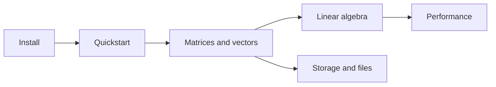

# Guides

A path through PyCauset, from first install to tuning a large run. Work top to
bottom the first time, then come back to whatever section you need.

## Start here

- **[[guides/Installation|Installation]]** — pip or from source.
- **[[guides/Quickstart|Quickstart]]** — ten minutes to linear algebra on a causal matrix.
- **[[guides/User Guide|User Guide]]** — the guided tour of the engine.
- **[[guides/Examples|Examples]]** — short, copy-paste recipes.

## Causal sets

- **[[guides/Causal Sets|Causal Sets]]** — sprinkle into the Minkowski diamond, read the order.
- **[[guides/Analyzing a Causal Set|Analyzing a Causal Set]]** — links, chains, layers, intervals, dimension.
- **[[guides/Visualization|Visualization]]** — plot the embedding, the Hasse diagram, the causal matrix.

## Data in and out

- **[[guides/Saving and Loading Data|Saving and Loading Data]]** — save, load, and convert `.pycauset` / `.npy` / `.npz`.
- **[[guides/Numpy Integration|NumPy Integration]]** — moving data between PyCauset and NumPy.
- **[[guides/Storage and Memory|Storage and Memory]]** — how large objects spill to disk and how to control it.

## The matrix engine

- **[[guides/Matrix Guide|Matrix Guide]]** — matrix types, dtypes, and operations.
- **[[guides/Vector Guide|Vector Guide]]** — vectors and vector arithmetic.
- **[[guides/Linear Algebra Operations|Linear Algebra Operations]]** — matmul, solves, factorizations, spectral/SVD.
- **[[guides/NxM Support|NxM Support]]** — what is and isn't rectangular yet.

## Views and laziness

- **[[guides/Lazy Evaluation|Lazy Evaluation]]** — which results are views, and when they materialize.

## Scale and tuning

For large runs and when you need to control the machine.

- **[[guides/Performance Guide|Performance Guide]]** — what is accelerated, and how to keep it that way.
- **[[guides/Advanced Usage|Advanced Usage]]** — memory, threads, storage location, IO traces.

---

## When you need exact details

- [[docs/index|API Reference]] — signatures and behaviors.
- [[internals/index|Internals]] — how it works under the hood.
