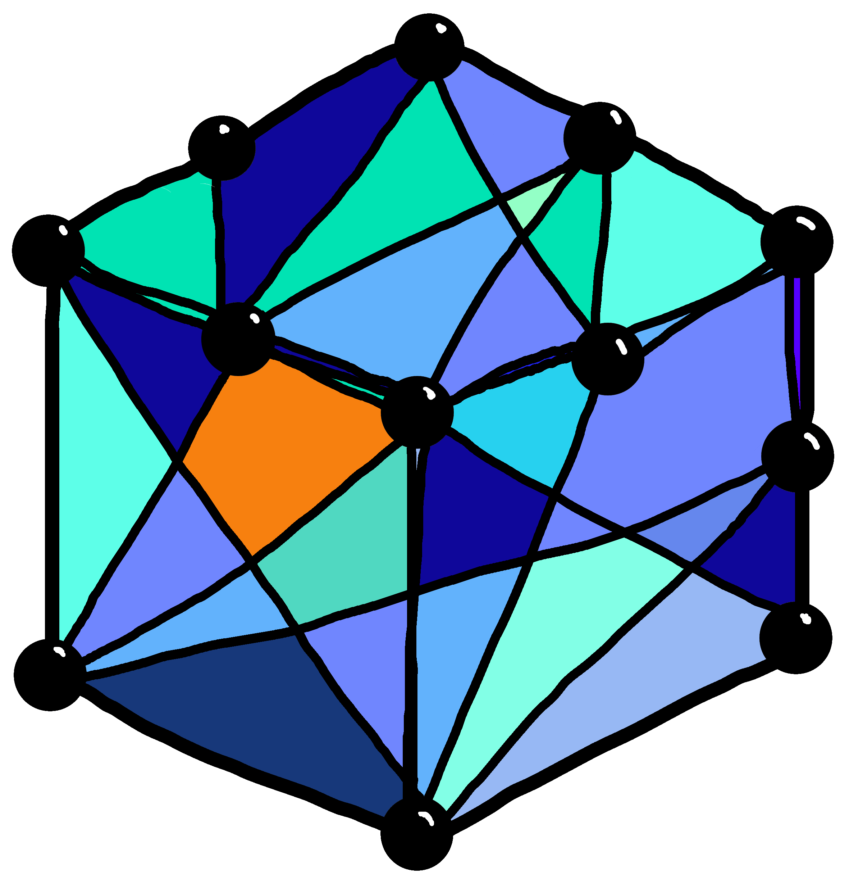

<h1 class="visually-hidden">PyCauset</h1>

**NumPy for causal sets: a matrix engine for numerical causal set theory**

[Get started](guides/index/){ .md-button .md-button--primary }
[API reference](docs/index/){ .md-button }

## Welcome to PyCauset

Causal set theory runs on large matrices: a causal set of $N$ elements has an
$N \times N$ causal matrix, and its physics is linear algebra on it (powers, closures,
propagators, spectra). PyCauset is that linear algebra with [NumPy](https://numpy.org/)'s
interface and results, built for these matrices: causal matrices stored one bit per element,
classes that know their structure (triangular, symmetric, diagonal, ...), and storage that
moves to disk when RAM runs out. Small matrices behave like NumPy arrays; large ones are
limited by disk and time. See the [philosophy](project/Philosophy/) page.

The physics layer (spacetimes, sprinkling, fields, plots) is parked while R1 completes the
engine.

## Documentation

-   :material-compass-rose: **Guides**

    ---

    Practical tutorials and conceptual explanations.

    - [[guides/Installation|Installation]]
    - [[guides/Quickstart|Quickstart]]
    - [[guides/User Guide|User Guide]]
    - [[guides/Linear Algebra Operations|Linear Algebra]]
    - [[guides/Performance Guide|Performance]]
    - [[guides/Storage and Memory|Storage]]

-   :material-code-braces: **API Reference**

    ---

    Detailed documentation of classes and functions.

    - [[docs/classes/index|Classes]]: matrix and vector classes by structure
    - [[docs/functions/index|Functions]]: `matmul`, `solve`, `eigh`, and more

-   :material-brain: **Internals**

    ---

    Deep dive into the C++ core and the design philosophy.

    - [[project/Philosophy|Philosophy]]
    - [[internals/Compute Architecture|Compute Architecture]]
    - [[internals/Memory and Data|Memory & Data]]
    - [[internals/Algorithms|Algorithms]]

## Citation

If you use PyCauset in your research, please cite the repository:
[https://github.com/BrorH/pycauset](https://github.com/BrorH/pycauset)
