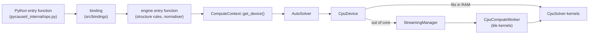

# Compute Architecture

How an operation reaches a kernel. R1 runs on the CPU only; the CUDA backend is parked in
`experimental/cuda` (its README lists the dormant hooks still in the core).

## The path of an operation

- **Entry function.** Each operation has one: it applies the structure rules (which class
  the result is), the normaliser (views read in place) and allocates the result. The
  procedure is [[project/protocols/Adding Operations|Adding Operations]].
- **`ComputeContext`** (`src/compute/ComputeContext.cpp`): a singleton whose device is an
  `AutoSolver`.
- **`AutoSolver`** (`src/compute/AutoSolver.cpp`): the device router. With no GPU device
  loaded (always, in R1) every call goes to `CpuDevice`. Its GPU routing, cost model and
  pinned-memory calls are dormant CUDA hooks, kept by design (review/DEADCODE.md).
- **`CpuDevice`** (`src/compute/cpu/CpuDevice.cpp`): picks in-memory or out-of-core
  execution. Matmul and element-wise operations stream when the operands and result do not
  fit (`out_of_core`); everything else runs in memory.
- **`CpuSolver`**: the kernels, split by family:

| File | Kernels |
|---|---|
| `CpuMatmul.cpp` | dense GEMM (BLAS), structured and bit matmul (`popcount`) |
| `CpuElementwise.cpp` | `+ - * /`, bitwise ops, packed structured element-wise |
| `CpuLinalg.cpp` | LAPACK factorizations and eigensolvers (`eigh`, `eig`, `cholesky`, `lu`, `qr`) |
| `CpuSolver.cpp` | dot, norms, matrix-vector (dense: BLAS gemv; structured: over the packed storage, see below), `compute_k`, `svd`, `solve` |
| `CpuIterative.cpp` | Arnoldi, skew eigensolvers |
| `CpuKernelsCommon.hpp` | shared helpers |

Kernels that need a structured, transposed, windowed or bit operand as rows read it through
the bulk reader (`math/RawRows.hpp`: stored values a tile of rows at a time, transposes
gathered in blocks) and apply the view rule themselves; plain dense operands are read in
place. Matrix-vector products of structured matrices run over the packed storage: diagonal
directly, triangular as gathers (scatters when transposed), and the symmetric family as one
pass that gathers each stored row and scatters its mirror (real: four rows at a time, partial
buffers per thread).

## Out-of-core execution

`StreamingManager` (`src/compute/StreamingManager.cpp`) tiles a matmul or element-wise
operation to fit the `MemoryGovernor` budget and hands each tile to a `ComputeWorker`
(`include/pycauset/compute/ComputeWorker.hpp`: `matmul_tile`, `elementwise_tile`). The only
worker is `CpuComputeWorker`, which calls the in-memory kernels on the tile. Details:
[[internals/Streaming Manager|Streaming Manager]].

## LAPACK

Factorizations and eigen problems call LAPACKE in the operand's precision (single stays
single, as in NumPy) and need the matrix in memory. They are called **column-major on the
row-major buffer**, which is the column-major transpose `A^T`, so LAPACKE never transposes
operands in and out (row-major calls did, and that cost about half of each factorization;
F-108). Each routine is chosen so that `A^T` gives `A`'s answer:

| Operation | LAPACK |
|---|---|
| `eigh`, `eigvalsh` | `?syevd` / `?heevd` on `A^T`'s upper triangle (= `A`'s lower, NumPy's `UPLO`); vectors transposed (and conjugated) once |
| `eig`, `eigvals` | `?geev` |
| `svd` | `?gesdd` on `A^T` (job `N` without vectors): its `U` and `V^H` are `A`'s `V^H` and `U` |
| `solve`, `invert` | `?getrf` on `A^T`, then two right-sided `?trsm` and the row interchanges on `B`'s buffer (the algorithm of `?gesv`; `invert` solves `A X = I`, as NumPy does) |
| `determinant`, `slogdet` | `?getrf` on `A^T` (`det(A^T) = det(A)`) |
| `lu` | `?getrf` (row-major: the factors of `A` itself are returned) |
| `cholesky` | `?potrf('U')` on `A^T`: `L` lands in the buffer's lower triangle |
| `qr` | `?gelqf` + `?orglq` / `?unglq` on `A^T`: the LQ of `A^T` is NumPy's QR of `A` transposed (same signs) |
| `pinv` | via `svd` |
| `lstsq` | `?gelsd` (NumPy's routine and cutoff), on column-major copies |
| `eig`, `eigvals` | `?geev` (row-major: the transposes are small next to it) |

Structure shortcuts come first: the determinant of a triangular or diagonal matrix is the
product of its diagonal, an identity's is `scale^n`, and so on.

`eigvals_arnoldi(a, k, m, tol)` needs only matrix-vector products, so it works on
file-backed matrices that do not fit in RAM.

## Parallelism and SIMD

- **`ParallelFor`** (`include/pycauset/core/ParallelUtils.hpp`): a thread pool with dynamic
  chunks; threads take `range / (threads * 4)`-sized chunks from an atomic counter, so one
  thread stalled on a page fault does not hold the others. `pc.set_num_threads` caps it.
- **SIMD:** dense float32 / float64 `+ - * /` have AVX2 kernels, chosen at run time
  (`cpuid`); other dtypes use compiler-vectorised loops. Bit matrices use hardware
  `popcount`.

## Seeing what ran

- `pc.last_io_trace(op)`: the kernels an operation ran, its operands and whether it
  streamed ([[internals/Streaming Manager|Streaming Manager]]).
- `pc._debug_last_kernel_trace()` / `pc._debug_clear_kernel_trace()`: the engine's kernel
  log (thread-local), used by the tests and the operation atlas.

## See also

- [[internals/Streaming Manager|Streaming Manager]]
- [[internals/Memory and Data|Memory and Data]]
- [[internals/Algorithms|Algorithms]]
