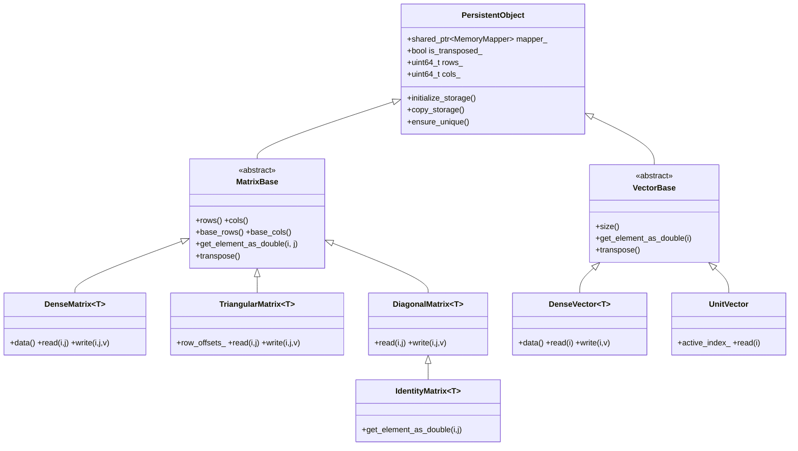

# Memory & Data Architecture

How PyCauset stores matrices and vectors, and how it decides whether a given
object lives in RAM or on disk.

## Tiered storage

PyCauset can handle matrices larger than RAM. It does that by keeping each object
in one of two places:

- **RAM** — anonymous memory (`VirtualAlloc` on Windows, `mmap` with a shared-memory
  fd on macOS/Linux). The fast path.
- **Disk** — a memory-mapped file, either a temporary session file (`.tmp`) or a
  persisted `.pycauset` snapshot.

Objects start in RAM and spill to disk when the `MemoryGovernor` decides there is
no room, or when you ask for disk directly (`storage="disk"` on `matrix()`).

## PersistentObject

Every matrix and vector inherits from `PersistentObject`. It owns a `MemoryMapper`
(which does the low-level map/unmap calls) and remembers whether the object is
RAM-backed or disk-backed.

- On creation it decides RAM vs disk, creates the backing store, and maps it.
- On destruction it unmaps, and if the backing was a temporary file, deletes it.

### Snapshot immutability

A persisted `.pycauset` file behaves like an immutable snapshot once loaded:

- Loading it gives you a snapshot-backed view.
- Mutating it does not overwrite the snapshot file. The object switches to a
  copy-on-write working copy instead.

See [[guides/Storage and Memory]] for the user-facing policy.

## The Memory Governor

`MemoryGovernor` is the singleton that decides what fits and what spills.

- **Budget.** It polls the OS for actually-available RAM (using `free + inactive`
  pages on macOS, `MemAvailable` on Linux) and keeps a safety margin (10% of RAM
  or 2 GB, whichever is smaller).
- **Tracking.** It keeps every `PersistentObject` in an LRU list. Touching an
  object moves it to the front.
- **Eviction.** `request_ram(size)` returns true when `available > size + margin`.
  Otherwise it spills the least-recently-used objects to disk until there is room.

```cpp
// In PersistentObject::initialize_storage
if (MemoryGovernor::instance().request_ram(size_bytes)) {
    use_ram_buffer();
    MemoryGovernor::instance().register_object(this, size_bytes);
} else {
    use_disk_file();
}
```

### Direct path (the "anti-nanny" rule)

For operations that fit in RAM, streaming them through the tiled/out-of-core path
is slower than just letting the OS page them. When the operation's operands and result fit
in available RAM (`MemoryGovernor::can_fit_in_ram`, with the safety margin), the kernels run directly on the storage (BLAS on the mapped pages, the OS pager does
the I/O). Otherwise matmul and element-wise operations stream tile by tile
([[internals/Streaming Manager|Streaming Manager]]).

## IO Accelerator

`IOAccelerator` makes the disk-backed path fast by telling the OS what is coming.

- **Write:** `SetFileValidData` (Windows) / `fallocate` (Linux) reserves file space
  without zero-filling it, which removes the "import gap".
- **Read:** `PrefetchVirtualMemory` (Windows) / `madvise(MADV_WILLNEED)` or
  `MAP_POPULATE` (Linux) pulls pages into the page cache before the CPU faults on
  them.
- **Discard:** `OfferVirtualMemory` (Windows) / `MADV_DONTNEED` (Linux) lets the
  OS drop pages that will not be reused.

The workflow is: create (reserve space) -> prefetch -> compute -> discard.

Solvers declare their access pattern up front (sequential, strided, random, or
once) through `pycauset.AccessPattern` / `pycauset.MemoryHint`, and the accelerator
turns that into the right prefetch/discard syscalls.

## Export guard

A large object converted naively to a NumPy array would blow up RAM. The export guard
(`src/bindings/numpy_export_guard.hpp`, and `_internal/export_guard.py` for the Python-level
block matrices) is by size only: an export that would not fit in free RAM, or that exceeds
the `set_export_max_bytes` ceiling, raises unless `allow_huge=True`. Whether the object is
in RAM or in a file does not matter: spilling is automatic, so it is no reason to refuse
(F-016). See [[docs/functions/pycauset.to_numpy.md|pycauset.to_numpy]].

## File formats

There are two on-disk formats.

### `.pycauset` (snapshot container)

Portable, persistent storage for matrices and causal sets. Managed by
`python/pycauset/_internal/persistence.py`.

- A fixed header (magic `PYCAUSET`, version, and A/B slot pointers).
- Double-buffered slots for crash-consistent metadata updates.
- A typed, sparse metadata block (shape, dtype, structure, view state).
- A raw payload region at a stable, aligned offset so it can be mmap'd.

The payload is laid out exactly as it would be in memory (row-major dense, packed
words for bit matrices). Metadata updates never shift the payload.

### `.tmp` (session backing file)

Temporary storage for spilled objects and large intermediates. Managed by
`src/core/MemoryMapper.cpp`.

- A 64-byte header (magic + version + reserved).
- The raw payload.

The header stops a raw file from being mistaken for a `.pycauset` container (and
the other way around).

### Typed metadata is the only schema

All metadata is a typed top-level map. The important namespaces:

- `view` — view state (scalar, transpose, conjugation).

### Derived values

Results of whole-matrix computations (determinant, slogdet, trace, sum, the matrix norms,
rank, eigenvalues) are kept on the storage (`MemoryMapper`, shared by every view of the payload) and
returned on the next call: `include/pycauset/math/DerivedCache.hpp`. The storage carries a
version that `PersistentObject::ensure_unique` bumps before any write (it is the write gate of
copy-on-write), which drops every entry. Entries are keyed on the exact view (class, structure,
factor, conjugation, transposition) and the parameters, so a cached answer is bit-for-bit the
recomputed one; windows are not cached. `save` writes the scalar entries into the metadata
(`derived`: key, kind, values; the 128-bit integer sums as text) and `load` restores them; a
loaded snapshot is mapped copy-on-write, so its file never changes under them. The old cache went
stale on mutation and answered from user assertions (F-081). The user-assertion `properties` store is removed
(F-092): structure is the class.

## Matrix & vector hierarchy

The class hierarchy separates storage management from math:



### Lazy metadata

Small operations avoid touching the payload:

- Scaling a matrix updates `scalar_`; it does not multiply every element.
- Transposing toggles `is_transposed_`; the backing bytes stay row-major.

`rows()` / `cols()` are logical (they account for the transpose). `base_rows()` /
`base_cols()` are the backing dimensions.

### Storage vs view

The disk bytes are the storage; the C++ object is a view that interprets them and
applies metadata (scalar, transpose). `mapper_->get_data()` is the raw pointer.

## Type system and dispatch

PyCauset does not silently widen your types: float32 in, float32 out. Mixing float32 with
float64 in arithmetic gives float32 too ("underpromotion", with a `PyCausetDTypeWarning`;
NumPy gives float64); linear algebra follows NumPy's LAPACK dtypes. The rules:
[[internals/DType System]].

Dispatch is templated, not virtual-per-element. At the operation level the code
picks the instantiation for the operand dtype. See [[internals/DType System]].

## See also

- [[guides/Storage and Memory]] — the user-facing guide.
- [[internals/DType System]]
- [[docs/classes/matrix/pycauset.MatrixBase.md|pycauset.MatrixBase]]
