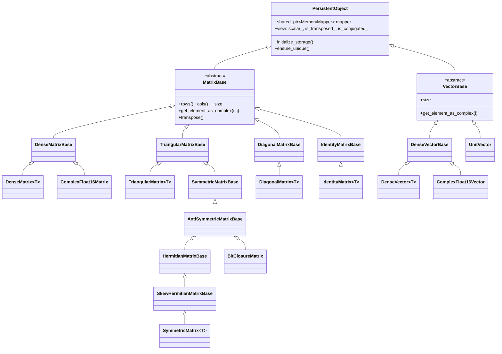

# Memory & Data Architecture

How PyCauset stores matrices and vectors, and how it decides whether a given
object lives in RAM or on disk.

## Tiered storage

PyCauset can handle matrices larger than RAM. It does that by keeping each object
in one of two places:

- **RAM** — the C heap (`calloc`, or `malloc` for results every byte of which is written:
  `UninitializedStorage`). The fast path.
- **Disk** — a memory-mapped file, either a temporary session file (`.tmp`) or a
  persisted `.pycauset` snapshot.

Each object is placed once, at creation: in RAM when it is below the memory threshold and
the `MemoryGovernor` has room, otherwise in a file (or when you ask, `storage="disk"`). It
is never moved later: kernels hold raw pointers into their operands (F-120).

## PersistentObject

Every matrix and vector inherits from `PersistentObject`. It holds a shared
`MemoryMapper` (the storage: heap memory or a mapped file; views and copy-on-write
siblings share one) and the view metadata.

- On creation it decides RAM vs file (below) and creates the storage.
- The storage goes with its last owner: the mapper's destructor frees the memory or
  unmaps the file, and deletes the file if it is temporary (auto-named, a copy, or an
  explicit `.tmp` name). A file the user named and a loaded snapshot are never deleted.
- On POSIX a mapped file keeps no open file descriptor (the mapping keeps the file
  alive), so the number of file-backed objects is not limited by the fd limit.

### Snapshot immutability

A persisted `.pycauset` file behaves like an immutable snapshot once loaded:

- Loading it gives you a snapshot-backed view.
- Mutating it does not overwrite the snapshot file. The object switches to a
  copy-on-write working copy instead.

See [[guides/Storage and Memory]] for the user-facing policy.

## The Memory Governor

`MemoryGovernor` is the singleton that decides what fits in RAM.

- **Budget.** It polls the OS for actually-available RAM (using `free + inactive`
  pages on macOS, `MemAvailable` on Linux) and keeps a safety margin (10% of RAM
  or 2 GB, whichever is smaller).
- **Placement.** A new object (or a copy-on-write copy) goes to RAM when it is below the
  memory threshold and `can_fit_in_ram(size)` (`available > size + margin`), otherwise
  to a temporary file. There is no registry: the OS's figure already counts PyCauset's
  own memory. Nothing already allocated is spilled: a running kernel holds raw pointers
  into its operands, and spilling one under it crashed (F-120).

```cpp
// PersistentObject.cpp
static bool place_in_ram(uint64_t bytes) {
    return bytes <= get_memory_threshold() && MemoryGovernor::instance().can_fit_in_ram(bytes);
}
```

### Execution on mapped storage

Kernels run directly on the storage, RAM or mapped file (BLAS on the mapped pages; the OS
pager does the I/O). There is no tiled path ([[internals/Out of Core|Out of Core]]).

## IO Accelerator

`IOAccelerator` makes the disk-backed path fast by telling the OS what is coming.

- **Create:** a new file is sized once (`fallocate`, `ftruncate` as fallback; Windows
  `SetEndOfFile`) and reads as zeros. (Windows' `SetFileValidData`, which skipped the zeroing,
  exposed stale disk contents and is gone, review 3.5 C-9.) A new file that fits in RAM is
  pre-faulted (`MAP_POPULATE` / a prefetch).
- **Read:** `PrefetchVirtualMemory` (Windows) / `madvise(MADV_WILLNEED)` or
  `MAP_POPULATE` (Linux) pulls pages into the page cache before the CPU faults on
  them.
- **Discard:** `OfferVirtualMemory` (Windows) / `MADV_DONTNEED` (Linux) lets the
  OS drop pages that will not be reused. Only shared file pages, which read back from the
  file: RAM storage and copy-on-write snapshots (written pages exist only in memory) are
  skipped, and only whole pages inside the range are dropped.

POSIX wants page-aligned addresses for `madvise` and `msync`, and the data starts 64 bytes
into the mapping (the header): `PageRange.hpp` widens a range to the pages it touches (sync,
read-ahead) or narrows it to the pages inside it (discard). A failed `msync` raises.

The workflow is: create (reserve space) -> prefetch -> compute -> discard.

Callers can declare an access pattern through `pycauset.MemoryHint` (`matrix.hint(h)`):
`Sequential` and `Strided` become read-ahead calls, the other patterns do nothing yet, and
no engine operation issues hints itself today. The block-matrix layer prefetches a leaf's
whole storage before using it and drops it after (`_io_prefetch` / `_io_discard`).

## Export guard

A large object converted naively to a NumPy array would blow up RAM. The export guard
(`src/bindings/numpy_export_guard.hpp`, and `_internal/export_guard.py` for the Python-level
block matrices) is by size only: an export that would not fit in free RAM, or that exceeds
the `set_export_max_bytes` ceiling, raises unless `allow_huge=True`. Whether the object is
in RAM or in a file does not matter: file backing is automatic, so it is no reason to refuse
(F-016). See [[docs/functions/pycauset.to_numpy.md|pycauset.to_numpy]].

## File formats

There are two on-disk formats.

### `.pycauset` (snapshot container)

Portable, persistent storage for matrices and causal sets. Managed by
`python/pycauset/_internal/persistence.py`.

- A fixed header (magic `PYCAUSET`, version, and A/B slot pointers).
- Double-buffered slots for crash-consistent metadata updates.
- A typed, sparse metadata block (shape, dtype, structure, view state).
- A raw payload region at a stable, aligned offset so it can be mmap'd.

The payload is laid out exactly as it would be in memory (row-major dense, packed
words for bit matrices). Metadata updates never shift the payload.

### `.tmp` (session backing file)

Temporary storage for objects placed in files (large ones, or those that did not fit RAM).
Named `<prefix>_<pid>_<n>.tmp`, so processes sharing a backing directory never collide (F-121). Managed by
`src/core/MemoryMapper.cpp`, which deletes the file when the storage's last owner goes.

- A 64-byte header (magic + version + reserved).
- The raw payload.

The header stops a raw file from being mistaken for a `.pycauset` container (and
the other way around).

### Typed metadata is the only schema

All metadata is a typed top-level map. The important namespaces:

- `view` — view state (scalar, transpose, conjugation).

### Derived values

Results of whole-matrix computations (determinant, slogdet, trace, sum, the matrix norms,
rank, eigenvalues) are kept on the storage (`MemoryMapper`, shared by every view of the payload) and
returned on the next call: `include/pycauset/math/DerivedCache.hpp`. The storage carries a
version that `PersistentObject::ensure_unique` bumps before any write (it is the write gate of
copy-on-write), which drops every entry. Entries are keyed on the exact view (class, structure,
factor, conjugation, transposition) and the parameters, so a cached answer is bit-for-bit the
recomputed one; windows are not cached. `save` writes the scalar entries into the metadata
(`derived`: key, kind, values; the 128-bit integer sums as text) and `load` restores them; a
loaded snapshot is mapped copy-on-write, so its file never changes under them. The old cache went
stale on mutation and answered from user assertions (F-081). The user-assertion `properties` store is removed
(F-092): structure is the class.

## Matrix & vector hierarchy

The class hierarchy separates storage management from math:



The `...Base` classes are the Python classes (one per structure, `.dtype` an attribute); the
templates are the per-dtype storage. `SymmetricMatrix<T>` is one class for the four packed
kinds (symmetric, antisymmetric, Hermitian, skew-Hermitian; its `kind_`), and derives from
every kind's base so that each Python class accepts it. `DenseMatrix<bool>` and
`TriangularMatrix<bool>` are bit-packed specialisations. Elements are read with `get(i, j)`
(stored values) and `get_element_as_complex` / `element_as_double` (through the view,
`math/ViewValue.hpp`); `set(i, j, v)` writes stored values after `ensure_unique()`.

### Lazy metadata

Small operations avoid touching the payload:

- Scaling a matrix updates `scalar_`; it does not multiply every element.
- Transposing toggles `is_transposed_`; the backing bytes stay row-major.

`rows()` / `cols()` are logical (they account for the transpose). `base_rows()` /
`base_cols()` are the backing dimensions.

### Storage vs view

The disk bytes are the storage; the C++ object is a view that interprets them and
applies metadata (scalar, transpose). `mapper_->get_data()` is the raw pointer.

## Type system and dispatch

PyCauset does not silently widen your types: float32 in, float32 out. Mixing float32 with
float64 in arithmetic gives float32 too ("underpromotion", with a `PyCausetDTypeWarning`;
NumPy gives float64); linear algebra follows NumPy's LAPACK dtypes. The rules:
[[internals/DType System]].

Dispatch is templated, not virtual-per-element. At the operation level the code
picks the instantiation for the operand dtype. See [[internals/DType System]].

## See also

- [[guides/Storage and Memory]] — the user-facing guide.
- [[internals/DType System]]
- [[docs/classes/matrix/pycauset.MatrixBase.md|pycauset.MatrixBase]]
